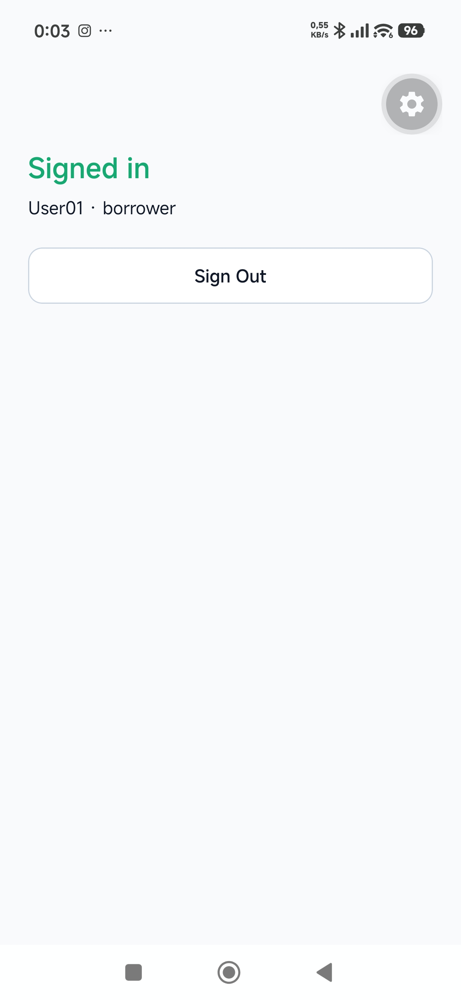
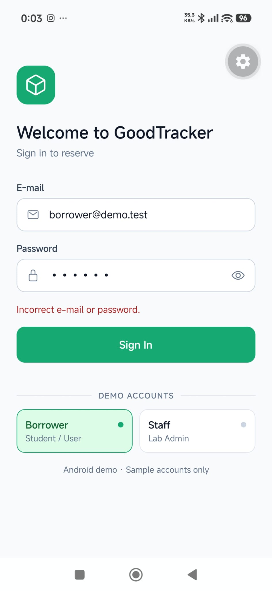
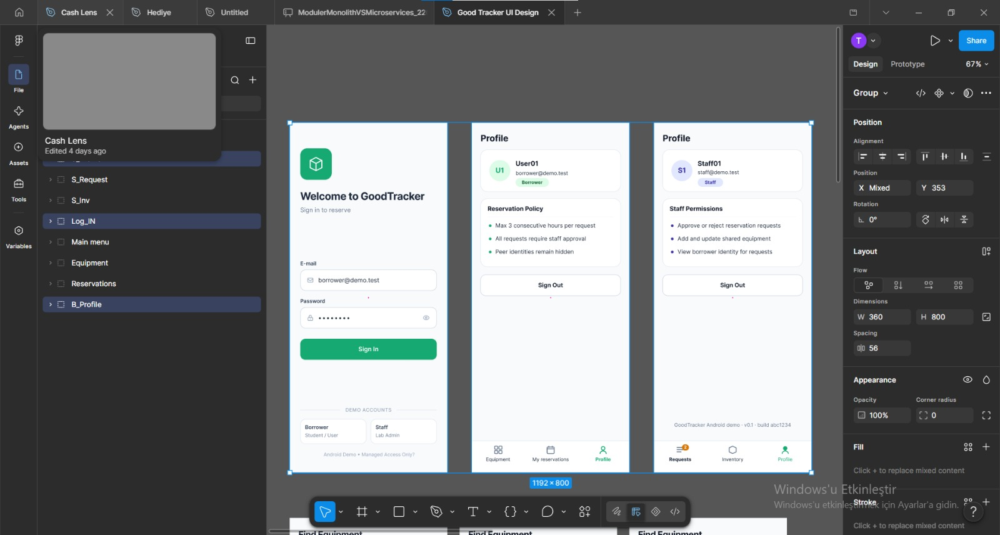
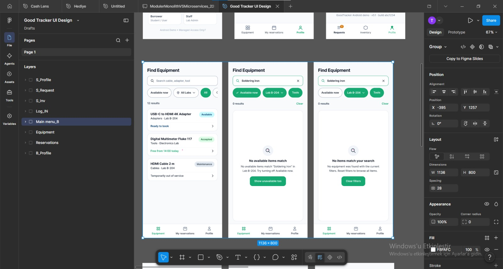
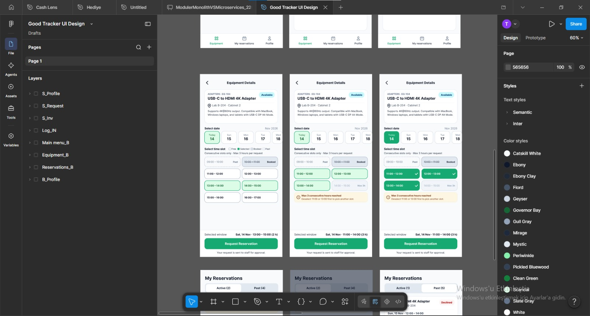
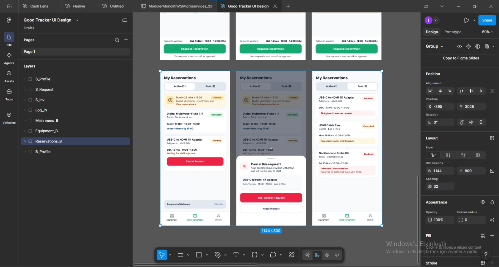
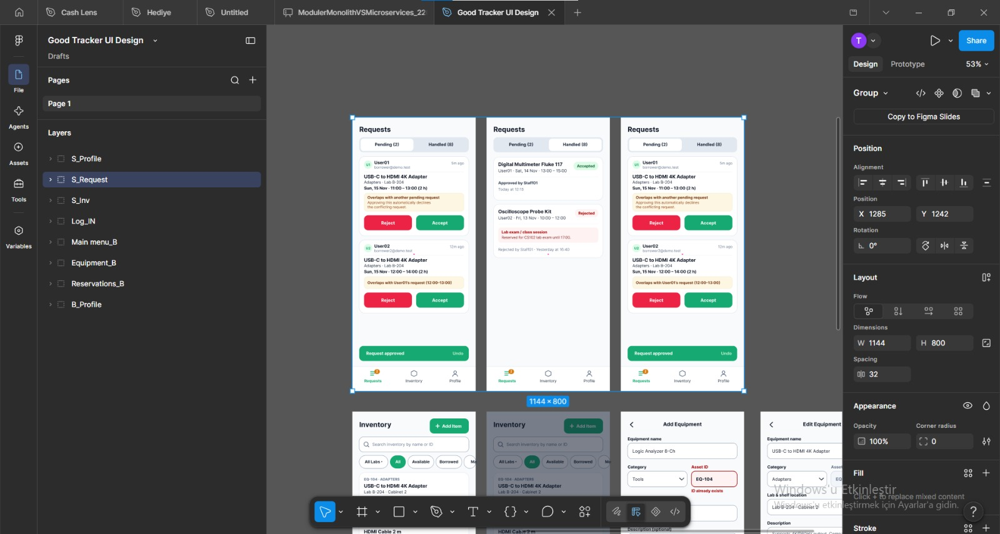

# M3 Increment Review

> Historical review of the 21 November build. A later API-backed increment is documented in [backend-increment.md](backend-increment.md). The screenshots below remain evidence of the older sign-in build only.

**Reviewer:** Talha Yılmaz | **Issue:** #10 | **Date:** 21 November 2026
**Build:** commit `73b1c70`, run with Expo Go on Android `redmi 15 pro`

## 1. What was reviewed

This review covers the mobile (frontend) part of the first increment, built in `mobile/`:

- Expo (React Native, TypeScript) project skeleton
- Shared theme (colors, radius, `MAX_HOURS = 3`), data types and sample data
- Sign-in screen with two demo accounts (Borrower and Staff)
- A temporary "Signed in" screen that shows the user name and role, with Sign Out
- These made to see our main color (Green) looks good or not. 

The app has no backend connection yet. Sign-in checks demo accounts stored inside the app. Only the sign-in flow runs; the other screens exist as Figma designs (Section 4.2) and will be implemented next.

## 2. Demo steps

1. In `mobile/`, run `npx expo start` and open the project in Expo Go on an Android phone.
2. The sign-in screen appears with the Borrower demo account selected.
3. Tap **Sign In**. The temporary screen shows "User01 · borrower" (Figure 1).
4. Tap **Sign Out**. The app returns to the sign-in screen.
5. Enter a wrong password and tap **Sign In**. The message "Incorrect e-mail or password." appears (Figure 2).
6. Tap the **Staff** card, then **Sign In**. The screen shows "Staff01 · staff". Same as the borrower but with a staff name on it i forgot to take a screenshot :/ 

## 3. Check against acceptance criteria

| Task | Acceptance criterion (from backlog) | Result | Evidence |
| :--- | :--- | :--- | :--- |
| TSK-03 | Valid accounts can sign in; staff-only actions reject borrower access. | Partly met. Borrower sign-in works and a wrong password is rejected. Staff-only actions do not exist yet, so the second part is not tested. | Figures 1, 2 |
| TSK-04 | Admins can register items and track status. | Not implemented in the app. | Design only: Figure 7 |
| TSK-05 | At most one booking for overlapping slots. | Not implemented. | Design only: Figure 5 |
| TSK-06 | Users see status and expected availability. | Not implemented. | Design only: Figure 4 |
| TSK-07 | In-app reminder appears at the agreed threshold. | Not implemented (Could). | Design only: Figure 6 |
| TSK-09 | Borrowers cancel only their own requests; only staff approve or reject. | Not implemented. | Design only: Figures 6, 7 |
| TSK-10 | Users can search by category or location. | Not implemented. | Design only: Figure 4 |

A design is not an implemented feature. Rows marked "Design only" count as not met.

## 4. Screenshots

### 4.1 Running app (Expo Go, Android)

*Figure 1: After signing in with the Borrower demo account, the temporary screen shows "User01 · borrower" and a Sign Out button.*

*Figure 2: The sign-in screen with the message "Incorrect e-mail or password." after a wrong password. The Borrower and Staff demo cards are shown below.*

### 4.2 Planned UI (Figma designs, not implemented yet)

These are design mockups, not working software. They show what will be implemented next.

*Figure 3: Planned sign-in screen and the Borrower and Staff profile screens (TSK-03). Only the sign-in screen is built.*

*Figure 4: Planned equipment list with search, filters, status badges and an empty state (TSK-10, TSK-06).*

*Figure 5: Planned equipment detail with date and time-slot selection, the 3-hour limit warning and consecutive-slot rule (TSK-05).*

*Figure 6: Planned My Reservations with a return reminder, cancel confirmation and past requests such as declined and cancelled (TSK-09, TSK-07).*

*Figure 7: Planned staff Requests screen with overlap warnings, approve and reject, and the start of the Inventory screens (TSK-09, TSK-04).*

## 5. Limitations and missing functionality

- No server or API connectivity at all. Password verification happens within the app only – it works for demo accounts only.
- No session storage is provided. Sign-out occurs with closing of the application by the user.
- Only authentication workflow has been implemented. Screen of equipment, booking process, My Reservations and Staff haven’t been developed.
- Has been tested only on one Android smartphone using Expo Go. Other screen dimensions aren’t tested (R-04).
- There are no automated testing procedures yet.

## 6. Feedback

No user feedback has been collected yet (not required yet for obvious reasons), because only the sign-in flow runs. Feedback will be collected once the equipment list and booking flow run on the phone.

## 7. Next steps

Dates are the internal sprint targets from the M2 schedule.

1. Sprint 2 (until 29 Nov): equipment list with search and filters (#39); equipment detail and time-slot selection with the 3-hour rule (#35).
2. Sprint 3 (30 Nov - 13 Dec): My Reservations with cancellation (#38); staff Requests and Inventory (#34, #38); connect the app to the API when the endpoints are ready.
3. Sprint 4 (14 - 27 Dec): acceptance checks and defect review on a named build.
